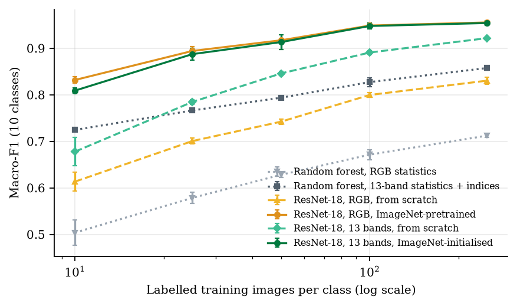
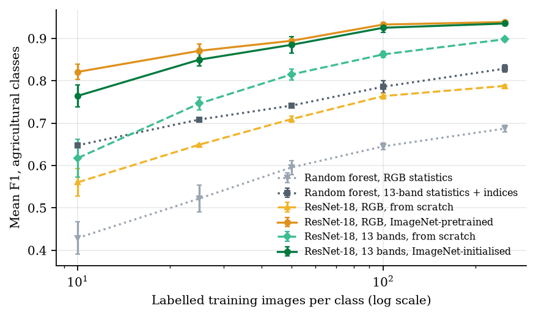
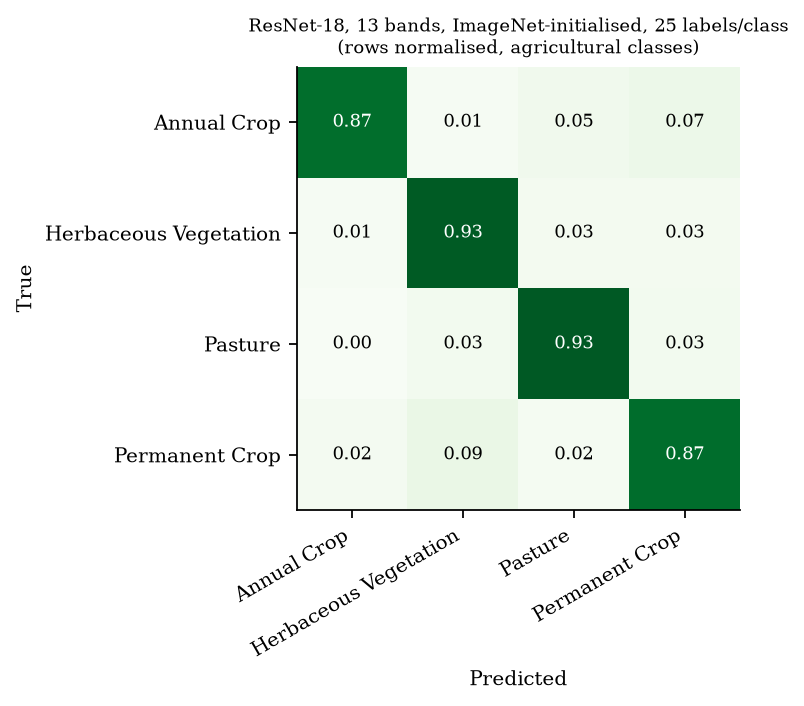

# Label-efficient crop and land-cover recognition from Sentinel-2

**Question.** When labelled satellite images are scarce, as they are for smallholder agriculture in much of Africa, what matters more for recognising crops and land cover: the extra spectral bands that Sentinel-2 provides, or a network pretrained on ordinary photographs?

**Short answer.** On EuroSAT, ImageNet pretraining is worth far more than spectral information when labels are scarce. A pretrained ResNet-18 trained on 10 RGB images per class (macro-F1 0.83) matches a ResNet-18 trained from scratch on 250 RGB images per class (0.83): about 25 times fewer labels. The 13 Sentinel-2 bands help a great deal when training from scratch (+0.06 to +0.10 macro-F1), but add nothing once ImageNet initialisation is used. Copying RGB-pretrained filters onto multispectral bands discards the spectral advantage, which points to multispectral pretraining as the next step.



## Data

[EuroSAT](https://github.com/phelber/EuroSAT) (Helber et al., 2019): 27,000 Sentinel-2 patches of 64×64 pixels with all 13 spectral bands, in 10 land-cover classes. Four of them are agricultural: Annual Crop, Permanent Crop, Pasture and Herbaceous Vegetation. Data are read from the [Hugging Face mirror](https://huggingface.co/datasets/blanchon/EuroSAT_MSI) of the official split.

- **Test set:** the full official test split, 5,400 images (396–609 per class), never used for any decision.
- **Training pool:** 9,050 images from the official training split, with at least 442 per class. The mirror stores training images sorted by class, so to limit download size the pool consists of one complete shard plus the five row groups that cover the remaining classes (`scripts/fetch_train_groups.py`). Training subsets are then sampled at random within each class.

## Methods

| Method | Input | Initialisation |
|---|---|---|
| Random forest (300 trees) | Per-band mean, std, 10th and 90th percentiles of B04/B03/B02 | — |
| Random forest (300 trees) | Same statistics for all 13 bands, plus mean and std of NDVI, NDWI and NDBI | — |
| ResNet-18 | RGB (B04, B03, B02) | Random |
| ResNet-18 | RGB | ImageNet |
| ResNet-18 | All 13 bands | Random |
| ResNet-18 | All 13 bands | ImageNet: RGB filters copied onto B04/B03/B02, the mean filter on the other 10 bands, rescaled by 3/13 |

All networks use the same fixed recipe, with no tuning on the test set:
- AdamW (learning rate 1e-3, weight decay 1e-4) with a one-cycle schedule;
- label smoothing 0.1;
- random flips and 90° rotations;
- per-band standardisation computed on each training subset;
- between 15 and 60 epochs, with more epochs for smaller subsets so the optimisation effort is comparable.

**Protocol.** Label budgets of 10, 25, 50, 100 and 250 images per class, each with 3 random seeds, for 90 training runs in total. Each run is scored by accuracy, macro-F1 over the 10 classes, and mean F1 over the four agricultural classes.

## Results

Macro-F1 on the 5,400-image test set, mean ± standard deviation over 3 seeds:

| Method | 10/class | 25/class | 50/class | 100/class | 250/class |
|---|---|---|---|---|---|
| Random forest, RGB statistics | 0.504 ± 0.027 | 0.579 ± 0.012 | 0.628 ± 0.006 | 0.672 ± 0.011 | 0.712 ± 0.004 |
| Random forest, 13-band statistics + indices | 0.725 ± 0.003 | 0.767 ± 0.004 | 0.794 ± 0.002 | 0.827 ± 0.010 | 0.858 ± 0.004 |
| ResNet-18, RGB, from scratch | 0.614 ± 0.021 | 0.701 ± 0.006 | 0.742 ± 0.006 | 0.800 ± 0.005 | 0.830 ± 0.008 |
| ResNet-18, RGB, ImageNet-pretrained | **0.832 ± 0.007** | **0.894 ± 0.009** | **0.917 ± 0.002** | **0.949 ± 0.002** | **0.956 ± 0.001** |
| ResNet-18, 13 bands, from scratch | 0.678 ± 0.031 | 0.785 ± 0.005 | 0.846 ± 0.005 | 0.891 ± 0.004 | 0.922 ± 0.003 |
| ResNet-18, 13 bands, ImageNet-initialised | 0.809 ± 0.006 | 0.888 ± 0.012 | 0.913 ± 0.016 | 0.948 ± 0.006 | 0.954 ± 0.005 |

Paired differences in macro-F1, same seed and training subset, with the range across the 3 seeds in brackets:

| Labels/class | ImageNet vs scratch (RGB) | 13 bands vs RGB (scratch) | 13 bands vs RGB (ImageNet) |
|---|---|---|---|
| 10 | +0.218 [+0.189, +0.243] | +0.064 [+0.007, +0.095] | −0.023 [−0.025, −0.020] |
| 25 | +0.194 [+0.189, +0.197] | +0.084 [+0.079, +0.089] | −0.007 [−0.012, +0.001] |
| 50 | +0.175 [+0.171, +0.182] | +0.104 [+0.095, +0.109] | −0.004 [−0.020, +0.014] |
| 100 | +0.149 [+0.142, +0.154] | +0.091 [+0.088, +0.093] | −0.001 [−0.010, +0.005] |
| 250 | +0.125 [+0.118, +0.135] | +0.091 [+0.086, +0.097] | −0.001 [−0.007, +0.002] |

**Agricultural classes.** Mean F1 over Annual Crop, Herbaceous Vegetation, Pasture and Permanent Crop is below the 10-class macro-F1 for every method and budget, because these classes are confused with one another. With 25 labels per class, the best model still assigns 9% of Permanent Crop patches to Herbaceous Vegetation. From scratch with RGB only, Herbaceous Vegetation F1 is 0.56 and Permanent Crop F1 is 0.60.

 

## Findings

1. **Pretraining dominates when labels are scarce.** ImageNet initialisation adds 0.22 macro-F1 at 10 labels per class and 0.13 at 250. Pretraining on 10 labels per class matches training from scratch on 250.
2. **Spectral bands substitute for missing pretraining, not for missing labels.** Without pretraining, the 13 bands add 0.06–0.10 macro-F1 at every budget. With only hand-crafted spectral statistics, a random forest beats an RGB CNN trained from scratch at every budget up to 100 labels per class.
3. **Naive transfer wastes the extra bands.** With ImageNet initialisation, 13 bands are no better than RGB, and are slightly worse at 10 labels per class (−0.023, consistent across seeds). The pretrained filters encode colour statistics of photographs, not spectral signatures of vegetation.
4. **Crops remain the hard part.** The classes that matter most for food-security monitoring are the ones the models confuse most.

## Limitations

- **Europe, not smallholder Africa.** EuroSAT covers European landscapes with large, regular fields; plots in Rwanda are often under a hectare, terraced and intercropped. The ranking of methods may not transfer.
- **Optimistic absolute accuracy.** EuroSAT's random split can place patches from the same area in both training and test sets, so absolute accuracies are likely optimistic. Comparisons between methods under the same split are more reliable.
- **Narrow design.** One architecture, one fixed training recipe, no hyper-parameter search, and three seeds per setting.
- **Patch classification only.** This is not field-level segmentation or crop-type mapping over time.

## Next steps

- Replace the naive band adaptation with backbones pretrained on multispectral imagery, such as SSL4EO-S12 or SatMAE, and test whether they recover the spectral advantage at low budgets.
- Repeat the study on African agricultural data, such as NASA Harvest / CropHarvest labels for Kenya and Togo, with geographically separated train and test areas.
- Move from patch classification to field-level segmentation and multi-date crop-type recognition.

## Reproduce

```bash
python3 -m venv .venv && .venv/bin/pip install -r requirements.txt
bash scripts/download.sh            # about 1.3 GB
cd src
../.venv/bin/python experiment.py   # 90 runs, about 16 minutes on an Apple M1 Pro GPU (MPS)
../.venv/bin/python report.py       # tables and figures in results/
```

Per-run metrics are in `results/runs.csv`, confusion matrices in `results/confusions.json`, and the console log in `results/experiment.log`.

## References

- Helber, P., Bischke, B., Dengel, A., & Borth, D. (2019). EuroSAT: A novel dataset and deep learning benchmark for land use and land cover classification. *IEEE Journal of Selected Topics in Applied Earth Observations and Remote Sensing*, 12(7), 2217–2226.
- He, K., Zhang, X., Ren, S., & Sun, J. (2016). Deep residual learning for image recognition. *CVPR*.

## Author

Hugues Ngabonziza, Kigali, Rwanda. Code written with the assistance of an AI coding tool; the study design, runs and analysis were reviewed by the author. MIT licence.
